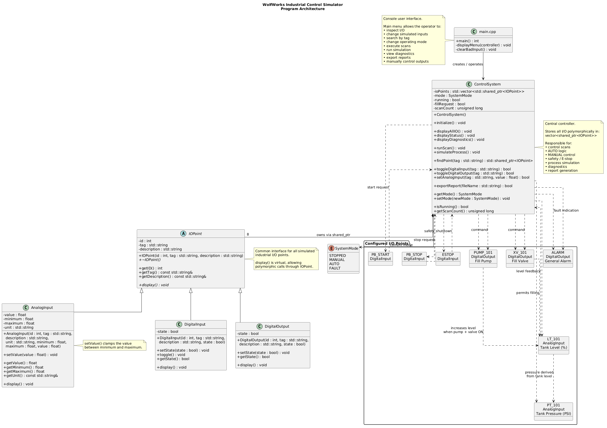

# WolfWorks Industrial Control Simulator

A C++17, terminal-based **industrial control / PLC-style simulator** built as a learning project. It models a tank-filling process with discrete pushbuttons, an emergency stop, analog level and pressure signals, a pump, a valve, and an alarm. The program uses an object-oriented I/O model and a scan-based controller to demonstrate industrial automation concepts alongside core C++ features.

> **Educational simulation only.** This program does not communicate with a real PLC or provide certified machine-safety functions.

## Project Overview

The simulator lets an operator inspect I/O, change operating modes, trigger simulated inputs, advance the controller one scan at a time or over multiple scans, view diagnostics, and export a text report. The automatic tank controller uses two level thresholds to avoid switching the pump on and off at a single setpoint.

### Key Features

- **Three selectable operating modes:** `STOPPED`, `MANUAL`, and `AUTO`, plus an automatically entered `FAULT` state.
- **PLC-style scans:** read input states, apply control and safety logic, then update the simulated process.
- **Automatic tank filling:** starts filling when level is at or below **20%** and stops at or above **80%**.
- **Manual output control:** operate simulated outputs in MANUAL mode, subject to run-state and safety restrictions.
- **Emergency-stop behavior:** disables the pump and valve, activates the alarm, and requires a controlled fault reset.
- **I/O diagnostics and tag lookup:** inspect device values and controller status.
- **Text report export:** save a snapshot of controller state and I/O values.
- **Object-oriented implementation:** an abstract base class, derived I/O classes, virtual methods, STL containers, and smart pointers.

## System Architecture



The diagram source is also included as [`digram.uml`](digram.uml).

| Class | Responsibility |
| --- | --- |
| `IOPoint` | Abstract base class containing the common ID, tag, description, and virtual display interface. |
| `DigitalInput` | Boolean inputs such as start, stop, and emergency stop. |
| `AnalogInput` | Numeric signals with units and bounded ranges. |
| `DigitalOutput` | Boolean actuator and alarm outputs. |
| `ControlSystem` | Owns the I/O collection and manages modes, scans, process behavior, diagnostics, and reporting. |

The controller stores mixed device types in a `std::vector<std::shared_ptr<IOPoint>>`, searches by tag using `std::find_if`, and uses virtual `display()` implementations to present device-specific information.

### Simulated I/O

| Tag | Type | Description |
| --- | --- | --- |
| `PB_START` | Digital input | Start pushbutton |
| `PB_STOP` | Digital input | Stop pushbutton |
| `ESTOP` | Digital input | Emergency stop |
| `LT_101` | Analog input | Tank level, 0–100% |
| `PT_101` | Analog input | Tank pressure, 0–100 PSI |
| `PUMP_101` | Digital output | Fill pump |
| `XV_101` | Digital output | Fill valve |
| `ALARM` | Digital output | General alarm |

### Control Logic

In **AUTO**, the pump and valve are enabled together when `LT_101 <= 20%`. Once enabled, they remain on until `LT_101 >= 80%`; this creates a simple hysteresis band. The process simulation increases tank level by **5 percentage points per scan** when both the pump and valve are on, and decreases it by **2 percentage points per scan** otherwise, while the system is running. Simulated pressure is recalculated as `10 + 0.4 × tank level` PSI.

The controller evaluates its logic before updating the process values in each scan. Therefore, an output change based on a newly reached threshold occurs on the **following scan**.

In **MANUAL**, the operator can control the pump and valve directly. **STOPPED** disables process outputs. Activating `ESTOP` during a scan forces **FAULT**, switches the pump and valve off, and activates `ALARM`. To recover, release the emergency stop, change mode to **STOPPED**, and then select another mode and start again.

## Instructions for Build and Use

### Steps to build and/or run the software

1. Install a C++ compiler supporting **C++17** (for example, GCC / `g++`) and open a terminal.
2. Clone the repository and enter its directory:

   ```bash
   git clone https://github.com/LoneWolf862/WolfWorks-Industrial-Control-Simulator.git
   cd WolfWorks-Industrial-Control-Simulator
   ```

3. Compile all `.cpp` files:

   ```bash
   g++ -std=c++17 -Wall -Wextra -Wpedantic -g *.cpp -o control_sim
   ```

4. Launch the simulator on Linux:

   ```bash
   ./control_sim
   ```

   On Windows with MinGW-w64, compile using `-o control_sim.exe` and run `control_sim.exe` from the terminal.

No third-party C++ libraries or external services are required.

### Instructions for using the software

The simulator displays a numbered menu:

| Selection | Action |
| --- | --- |
| `1` | Display controller status and all I/O |
| `2` | Toggle a digital input by tag |
| `3` | Set an analog input by tag |
| `4` | Search for an I/O point by tag |
| `5` | Select `STOPPED`, `MANUAL`, or `AUTO` |
| `6` | Run one controller scan |
| `7` | Run a specified number of simulation scans |
| `8` | Display diagnostics |
| `9` | Export a system report to a filename you provide |
| `10` | Toggle a manual output |
| `0` | Exit |

**Example: demonstrate automatic tank filling**

1. Enter `3`, specify `LT_101`, and set the value to `15`.
2. Enter `5` and select `2` for **AUTO**.
3. Enter `2` and specify `PB_START` to simulate pressing Start.
4. Enter `6` to run a scan. The controller starts and commands the pump and valve on.
5. Enter `7` and choose `15` scans to watch the level rise and the controller switch the outputs off after the high threshold is reached.
6. Enter `1` or `8` to inspect the final state.
7. Enter `9` and provide `control_report.txt` to export a snapshot. View it with `cat control_report.txt` on Linux.

**Example: demonstrate emergency-stop protection**

1. With the controller running, enter `2` and specify `ESTOP`.
2. Enter `6` to execute a scan and observe the **FAULT** state, alarm, and disabled outputs.
3. Enter `2` and specify `ESTOP` again to release the simulated emergency stop.
4. Enter `5`, select `0` (**STOPPED**) to reset the fault, and then select a new operating mode when ready.

**Note:** Changing modes does not automatically start the system. Toggle `PB_START` and run a scan to begin operation. Input tags are case-sensitive.

## Development Environment

To recreate the development environment, you need the following software and/or libraries:

- **C++17** language standard (`-std=c++17`).
- **GCC / g++** with C++17 support, or another compatible compiler. The exact compiler version used during development was not recorded.
- **Linux terminal** (developed/run on CachyOS Linux); the source is also suitable for compilation on other platforms with a compatible compiler.
- **Git** for source control and **GitHub** for repository hosting (optional for compiling a downloaded copy).
- **C++ Standard Library** headers including `<vector>`, `<memory>`, `<algorithm>`, `<iostream>`, and `<fstream>`; these ship with a standard C++ toolchain.
- **PlantUML** (optional), if you want to edit or regenerate the UML diagram from `digram.uml`.

The project uses plain `.cpp` and `.h` files; no package manager, build framework, or additional dependencies are necessary.

## C++ Concepts Demonstrated

This project addresses all five required module concepts:

1. **Conditionals:** `if`/`else` and `switch` statements for operating modes, safety interlocks, input handling, and level thresholds.
2. **Loops:** the persistent menu loop, multi-scan simulation loop, and iteration through the I/O collection.
3. **Functions:** separate methods for scans, process updates, input changes, tag lookup, diagnostics, and reporting.
4. **Classes:** five classes divided into header and implementation files.
5. **STL data structures:** `std::vector` and `std::shared_ptr`, along with algorithms such as `std::find_if`.

**Stretch challenge — inheritance with virtual functions:** `DigitalInput`, `AnalogInput`, and `DigitalOutput` inherit from abstract `IOPoint` and override its virtual display interface. The project also supports **file writing** through report export; it does not currently import saved files. Dynamic allocation is managed using smart pointers rather than explicit `new`/`delete` calls.

## Useful Websites to Learn More

These references are useful for the C++ concepts and tools used in this project:

- [LearnCpp](https://www.learncpp.com/) — C++ fundamentals, classes, inheritance, and memory management.
- [cppreference](https://en.cppreference.com/w/) — C++ language and standard library reference.
- [C++ `std::vector` reference](https://en.cppreference.com/w/cpp/container/vector) — dynamically sized STL collections.
- [C++ `std::shared_ptr` reference](https://en.cppreference.com/w/cpp/memory/shared_ptr) — shared ownership and smart pointers.
- [GCC documentation](https://gcc.gnu.org/onlinedocs/) — compiler options and C++ compilation.
- [PlantUML](https://plantuml.com/class-diagram) — creating and editing class diagrams.

## Future Work

The following items are potential improvements and extensions:

- [ ] Add file **import** to restore saved controller state or load custom configurations.
- [ ] Add automated unit and integration tests for modes, safety behavior, and level control.
- [ ] Create a graphical HMI with animated tank level, device indicators, and operator controls.
- [ ] Make I/O points and control thresholds configurable rather than hard-coded.
- [ ] Add timestamps and optional CSV logging for trend analysis.
- [ ] Improve the physical process model with configurable fill/drain rates and sensor behavior.
- [ ] **Integrate the C++ simulator into the WolfWorks website as a backend application.** Adapt the simulation engine so it can run server-side and expose controlled interfaces (such as an API) to the website.
- [ ] **Connect the virtual PLC to the WolfWorks database and existing PLC engineering tools.** Allow the simulator to retrieve compatible configuration and engineering data produced by the site's PLC tools, and save simulation configurations and results for later use.
- [ ] **Build an interactive browser-based PLC simulator and HMI.** Provide a graphical tank/process display where visitors can toggle inputs, adjust analog signals, change operating modes, run scans, and observe outputs and alarms in real time.
- [ ] **Create an end-to-end virtual PLC workflow.** Let users configure a simulated control system using the WolfWorks tools, load that configuration into the virtual PLC, interact with it through the website GUI, and review stored results.
- [ ] Add a portable build configuration such as CMake.

## Long-Term Vision: WolfWorks Web-Based Virtual PLC

The long-term goal is to evolve this standalone C++ console project into a **virtual PLC simulation service hosted on the [WolfWorks website](https://wolfworks.tech/)**. The current C++ application would form the foundation of the **backend simulation engine**, while a browser-based graphical interface would act as the operator-facing HMI.

The planned website integration would connect the simulator with the **WolfWorks database and existing PLC-related engineering tools**. Instead of entering every value manually in a terminal, a user could work with data and configurations from those tools, load relevant values into a virtual controller, and watch the simulated process respond. A future implementation could also store configurations, session data, and simulation results in the website database.

The envisioned interaction is:

1. **Configure:** Use WolfWorks PLC tools or stored database records to prepare I/O and process parameters.
2. **Load:** Pass that configuration to the server-side C++ simulation engine through a defined application interface.
3. **Operate:** Use an interactive website GUI to press virtual buttons, adjust analog inputs, change operating modes, and execute or continuously run PLC scans.
4. **Observe:** View tank level, pressure, pump/valve status, alarms, and diagnostics in a graphical HMI.
5. **Review:** Save or retrieve simulation results and configurations for testing, demonstrations, and learning.

This is a **future development direction, not a feature of the current release**. The current version is a self-contained C++17 command-line simulator; it does not yet provide a web API, website integration, database connectivity, or browser GUI.

## Project Status

The command-line simulator implements the planned core features, including automatic and manual control, emergency-stop handling, diagnostics, tag lookup, and report export. Future enhancements above are **not** included in the current release.

---

*WolfWorks Industrial Control Simulator — a C++ learning project inspired by industrial PLC systems.*
